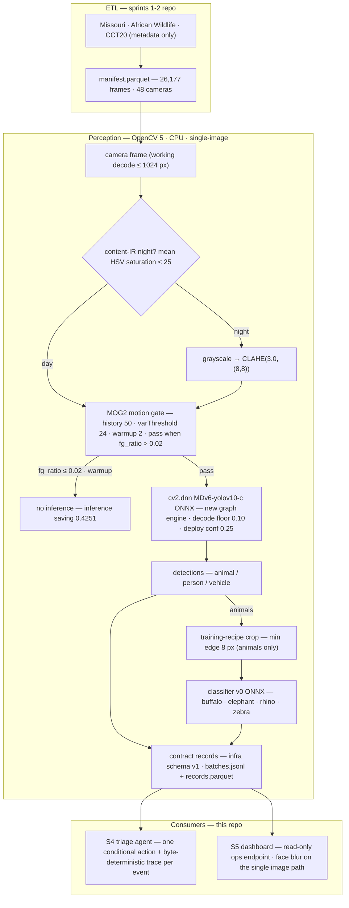
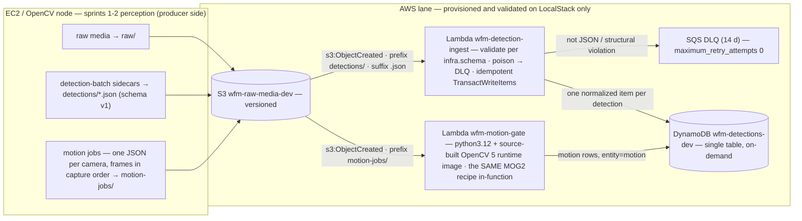
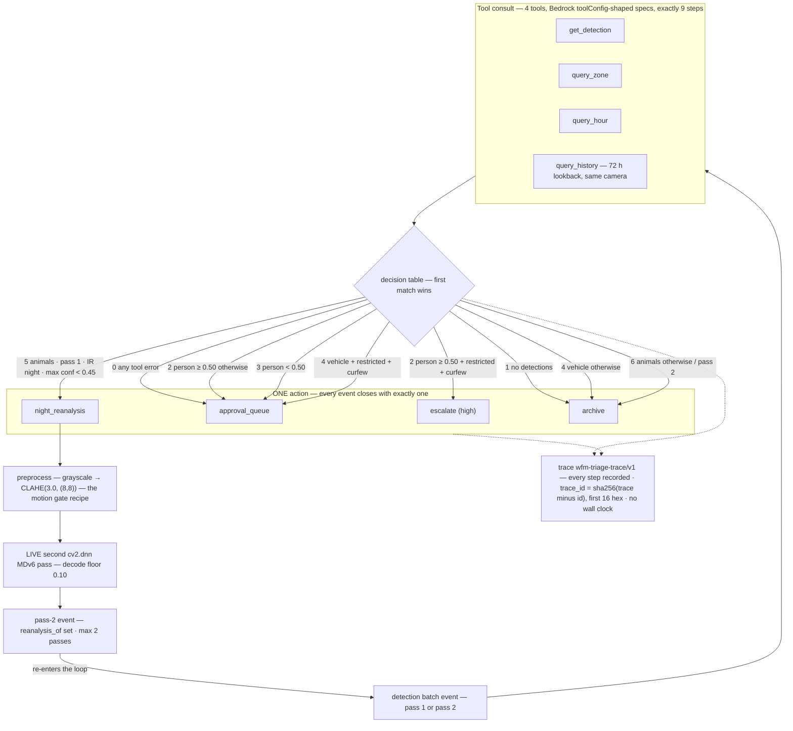

# Architecture — the two-repo wildlife monitor

Camera-trap wildlife monitor for the OpenCV AI Competition 2026 (Agentic
Vision track), built as **two repos that submit together**. The
sprints-1-2 repo (clone-relative `../wildlife-monitor`) holds the ETL
over three camera-trap datasets, the MDv6 `cv2.dnn` port, and classifier
v0 training. This repo (`wildlife-monitor-ext`) holds everything built
on top of it: the AWS ingest slice (`infra/`), the E2E union stage
(`pipeline/`), the G3 perception and S5 final evaluations (`eval/`), the
S4 triage agent (`agent/`), and the S5 read-only dashboard
(`dashboard/`). `STATUS.md` is the canonical sprint state; this file is
the system map — what talks to what, which parts are real, and where
every number comes from.

## 1. Two-repo layout

    projects/             (any parent dir)
    ├── wildlife-monitor/        sprints-1-2: ETL, detector port, classifier v0  (../wildlife-monitor)
    └── wildlife-monitor-ext/    this repo: infra, pipeline, eval, agent, dashboard

## 2. System architecture

The manifest is a read-only input here: the ETL lives in the sprints-1-2
repo and this repo never modifies it. CCT20 is metadata-only in this
repo (images never downloaded) and excluded from every evaluation stage.

Perception constants, all pinned and mirrored wherever the recipe runs:

| constant | value | defined / measured |
|---|---|---|
| working decode | ≤ 1024 px | sprints-1-2 decode path |
| night test | mean HSV saturation < 25 on the working decode (content-IR) | `eval/G3-REPORT.md`; the manifest's synthetic `is_night` agrees at chance level and never splits a number |
| night preprocess | grayscale → CLAHE(3.0, (8,8)) | the motion recipe, reused by the gate and pass-2 re-analysis |
| MOG2 gate | history 50 · varThreshold 24.0 · detectShadows False · learningRate −1.0 · warmup 2 frames/camera · pass when fg_ratio > 0.02 | local pass and motion Lambda, constants mirrored, boundary unit-tested |
| detector | MDv6-yolov10-c ONNX via `cv2.dnn`, new graph engine, decode floor 0.10, deploy conf 0.25 | sprints-1-2 port; classic engine kept as ablation |
| crops | training-recipe windows, min edge 8 px | trainer arithmetic pinned by pipeline tests |
| classifier | v0 ONNX, 4 AW species (closed set) | 0.9867 held-out top-1 |
| records | `infra/schema.py` v1 | `batches.jsonl` (upload shape) + `records.parquet` (analytics rows) |

Both consumers read the same local artifacts — the agent walks the
contract batches (200-event corpus) joined to the manifest and the G3
IR flags; the dashboard serves them read-only. `pipeline` imports
`infra.schema` read-only; `infra/` was not modified by later sprints.

## 3. AWS / LocalStack lane

Table design (single table, on-demand billing; names as deployed to the
`dev` environment):

| entity | keys | answers |
|---|---|---|
| base | `pk=CAM#<camera>`, `sk=<ts>\|<det_id>` | timeline of what camera X saw |
| gsi-species | `gs1pk=SPECIES#<species>`, `gs1sk=sk` | all zebras (or unlabeled animals) |
| gsi-source | `gs2pk=SRC#<media key>`, `gs2sk=sk` | everything detected in image Y |
| ingest marker | `pk=IDEP#<sha256(bucket\|key\|version)>`, `sk=BATCH` (motion jobs: `sk=MOTIONJOB`) | was version V already ingested? |

Idempotency is two layers: a fast-path marker `GetItem` keyed by object
version, and deterministic detection ids written under
`attribute_not_exists` in chunked `TransactWriteItems` (60/chunk) — a
re-put with a new versionId or a redelivered event produces 0 duplicate
rows.

| failure | handling | ends up |
|---|---|---|
| not JSON / structural schema violation | raise poison error | SQS DLQ, retry 0 (human looks) |
| one bad detection in a valid batch | skip + WARNING | 0 rows for it, rest ingested |
| duplicate delivery / re-put | marker + transaction guards | 0 duplicate rows |

The motion path is Gate G1's AWS half: `motion-jobs/<dataset>/<camera>.json`
triggers `wfm-motion-gate`, whose execution image
(`wfm-lambda-py312-opencv5:g1`, Ubuntu 24.04 + the project's source-built
OpenCV 5, harvested from the pipeline venv) runs the **same MOG2
recipe in-function** — decode → cap 1024 → grayscale+CLAHE on content-IR
night → MOG2 → fg_ratio → gate. `cv2.__version__` is read inside the
handler and stamped on every row as `model_runtime` — the import is the
point of the gate, so it carries its own evidence. Measured over the
African Wildlife dataset (1,504 images, 24 cameras) in
`infra/G1-AWS-REPORT.md`.

**Deployment reality (stated plainly):** Terraform + LocalStack 4.14.0
validated end to end (compose up → apply → upload → assert → DLQ →
teardown); 90 moto-backed unit tests run without docker. There are **no
cloud credentials anywhere in this repo** and **nothing has been
deployed to real AWS**. The same Terraform targets real AWS by setting
`aws_endpoint = ""`; the motion handler deploys unchanged there (zip +
container image instead of the LocalStack runtime mapping).

## 4. Agentic flow — perception → decision → action

Decision table (`agent/adapters.py`, provenance per constant in
`agent/policy.py`):

| # | condition (in order) | action |
|---|---|---|
| 0 | any tool errored | approval_queue (normal) — safe default |
| 1 | no detections | archive |
| 2 | person ≥ 0.50 | restricted zone AND curfew active → **escalate (high)**; else approval_queue (normal) |
| 3 | person < 0.50 present | approval_queue — high iff ≥ 2 person events in the 72 h history (repeat signal), else normal |
| 4 | vehicle (no person) | restricted + curfew → approval_queue (ranger check); else archive |
| 5 | animals, pass 1, content-IR night, max conf < 0.45 | **night_reanalysis** (pass 2 re-enters the loop) |
| 6 | animals otherwise / pass 2 | archive (species annotates only) |

The `night_reanalysis` branch is the loop edge and the G4 gate's core
sequence, executed live in demo s2: pass-1 animal 0.3417 on a content-IR
night frame → grayscale+CLAHE → a REAL second MDv6 pass decoded at floor
0.10 finds **four** marginal animal boxes the deploy floor never
surfaced (max 0.1979) → the pass-2 event (`reanalysis_of` set; the guard
refuses a third pass) re-enters the loop → archive on the pass-2 output,
not the pass-1 one.

Invariants held everywhere:

- **Consult is uniform** — exactly 9 steps recorded for every event, no
  wall clock anywhere; `trace_id = sha256(trace minus id)[:16]`, so
  re-runs reproduce every trace byte-identically.
- **Loop safety** — the `MAX_STEPS` budget and any tool error both close
  with the documented safe default (approval_queue): a stuck agent can
  never drop an event or auto-act on it.
- **Person evidence always carries `approval_required` +
  `face_blur_required`** — nothing can override the approval flag; the
  product approves, never accuses.
- Night is ALWAYS the G3 content-IR flag, never the synthetic `is_night`.

Honest boundary: the default backend is `rules-v1`, deterministic by
design (offline-first); the Bedrock adapter is a documented stub that
refuses to run without credentials, and Bedrock spend was $0. Kill-switch
B over the 200-event corpus: 195/200 agree with a rules-only baseline;
all 5 divergences are blind baseline escalations of open-zone midday
person artifacts the agent queues at correct urgency — zero person
evidence dropped in either lane. A future Bedrock backend must beat
`rules-v1` on this same corpus before its cost is justified.

## 5. Where OpenCV 5 is substantive

OpenCV 5 is source-built (the sprints-1-2 venv; `src/opencv/` untracked)
and is the compute layer of every stage, not a convenience import:

| OpenCV 5 capability | where it runs | detail / measurement |
|---|---|---|
| MOG2 background subtraction | motion gate, local pass (G3 full manifest) **and** inside `wfm-motion-gate` on the OpenCV-5 runtime image | history 50 · varThreshold 24 · detectShadows False · learningRate −1 · warmup 2 · pass fg_ratio > 0.02; constants mirrored between both, boundary unit-tested; `cv2.__version__` stamped on every motion row |
| CLAHE night preprocessing | local gate + motion Lambda (night frames) + S4 pass-2 re-analysis | grayscale → CLAHE(3.0, (8,8)), applied only on content-IR night frames |
| `cv2.dnn` MDv6 inference | pipeline E2E union, G3/S5 eval, S4 live pass-2, dashboard live person pass | MDv6-yolov10-c ONNX; deploy engine = **new** graph engine (classic kept as ablation); forward p50 124.2 ms, e2e p50 148.47 ms (S5 800-image protocol, CPU) |
| letterbox + blob prep | detector input, every `cv2.dnn` call above | p50 8.3 ms per image (E2E union timings) |
| crop + resize (training-recipe) | classifier input path (E2E union, G3) | min-edge 8 px; recipe pinned against the trainer's verbatim arithmetic by tests |
| live MDv6 person pass at serve time | dashboard image route | conf floor 0.10, unioned with stored person boxes — protects frames whose stored pass found nothing |
| Gaussian head-band blur | dashboard image route (the single image path) | 3× Gaussian k=31 over the top 28% + 6%/side of each person box, destructive, re-encoded; `X-Face-Blur` header always states the outcome |
| engine comparison | S5 latency/cost table | new 148.47 · classic 162.16 · PyTorch legacy 168.41 ms e2e p50 → $3.67 / $4.01 / $4.16 per 1M (c7i.large); legacy +13% on identical inputs and weights |

## 6. Real vs simulated

Stated in the payload, not just in docs — traces and dashboard responses
carry their own provenance tags:

| item | status | where stated / tagged |
|---|---|---|
| perception payloads (S2 + E2E union `cv2.dnn` detections) | **real** | carried in every agent event and trace |
| content-IR night flags | **real** (computed from pixels) | every trace; synthetic `is_night` never used |
| pass-2 re-analysis pixels | **real** (live MDv6 forward at decision time) | demo transcript + committed traces |
| all metrics (recall, species, ladder, latency, cost) | **real** (measured, seeded, reproducible) | G3/S5 reports + `processed/` tables |
| ingest behavior (validation, idempotency, DLQ) | **real** (90 moto tests + LocalStack smoke) | `infra/VALIDATION.md` |
| zone policy (per-camera `zone_restricted` ETL flag) | simulated | tagged in every trace |
| curfew window (fixed 18:00–06:00) | simulated (policy constant) | tagged in every trace |
| camera clock (`camera_ts`: synthetic uniform assignment + fixed per-dataset UTC offset) | simulated | `clock_source: manifest-synthetic` in the event payload |
| pinned demo contexts (s3, s6 — real payloads on a documented context) | simulated | `clock_source: pinned-demo`, original corpus context recorded beside |
| dashboard map layout | schematic (no GPS in any local metadata) | stated in the `/api/cameras` payload itself |
| FP/camera/day day partition | counts measured, calendar simulated (synthetic clock) | S5 report §3 |

Two adjacent honesty notes: Wellington person P/R is reported as
**NOT_COMPUTABLE** (dataset absent, no local person GT — probe evidence
in `eval/S5-REPORT.md` §4) rather than fabricated, and the person-load
substitute (48 detections / 29 images / 18 cameras) is labeled as load,
not errors.

## 7. Key numbers

| number | value | provenance |
|---|---|---|
| detection recall @ deploy conf 0.25 | **0.7945** (parity protocol IoU ≥ 0.5; TP 812 / FP 676 / FN 210; precision 0.5457) | G3 on the S2 800-image sample; TP/FP/FN cross-checked exact in S5 |
| classifier v0 top-1 | **0.9867** micro (0.9852 macro) | AW test split, n=375 crops; torch reference reproduced bit-tight |
| sequence recall ladder (union → gated → selected) | **0.9349 / 0.8093 / 0.7535** | 215 GT sequences; selection loss 5.6%; trigger observed 0.8884 |
| e2e latency p50, CPU | **148.47 ms** (classic 162.16 · PyTorch legacy 168.41) | S5, 800 images, warmup 3 excluded |
| cost per 1M images | **$3.67** on c7i.large (legacy $4.16, +13%; assumptions stated; Graviton NOT MEASURED, at-parity arithmetic $2.99) | S5 latency/cost table |
| offline tests | **189 + 90** (23 pipeline + 49 eval + 79 agent + 38 dashboard; 90 infra on moto) | per-package suites, sprints-1-2 venv |

Source documents: `STATUS.md` (canonical), `infra/README.md`,
`pipeline/README.md`, `eval/G3-REPORT.md`, `agent/G4-REPORT.md`,
`dashboard/README.md`, `eval/S5-REPORT.md`.
