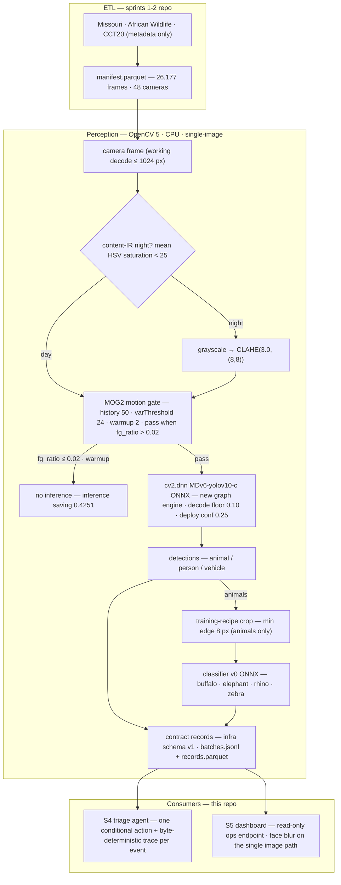
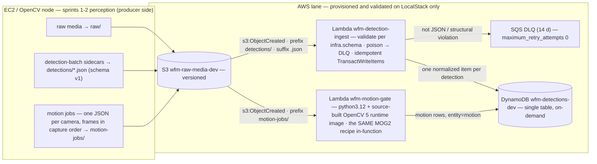
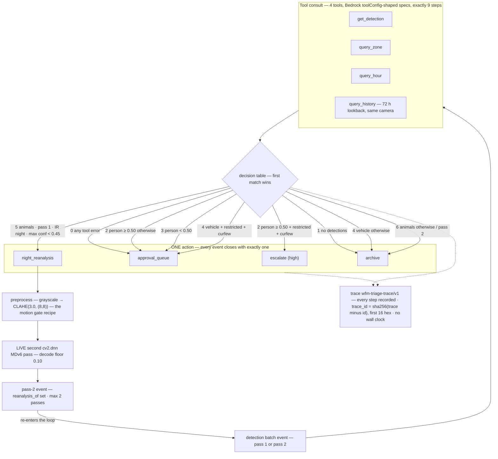

# Wildlife Agentic Monitor — tech report

Camera traps produce more frames than any field team can review. This
monitor triages every frame itself: OpenCV 5 motion gating (MOG2) and
detection (MDv6 via `cv2.dnn`), a species classifier, then a
tool-calling agent that decides — per event — what to re-analyze,
escalate, or archive. Humans only approve an evidence queue; people are
never an accusation: every person action carries `approval_required` +
`face_blur_required`, and the single image-serving path blurs faces
always, at serve time.

- Track: **Agentic Vision** (OpenCV AI Competition 2026).
- License: **Apache-2.0**.
- Two-repo layout: the sprints-1-2 core repo (`../wildlife-monitor`,
  clone-relative — ETL, motion gate, detector, classifier v0) plus this
  extension repo (infra, pipeline, eval, agent, dashboard). See §2.

## 0. Results at a glance

| gate | deliverable | verdict | headline |
|---|---|---|---|
| G1 | ingest slice S3 → Lambda → DynamoDB over LocalStack, plus a motion Lambda running MOG2 on OpenCV 5 | **MET** | 1,504/1,504 African Wildlife images end-to-end through the Lambda (OpenCV 5.0.0 imported inside the function), 0 missing / 0 extra / 0 DLQ — `infra/G1-AWS-REPORT.md` |
| G2 | detector parity, `cv2.dnn` vs PyTorch reference | **MET** (sprints-1-2; cross-checked here) | this repo's independent matcher reproduces the reference matcher's TP/FP/FN **identically — 812 / 676 / 210** at deploy conf 0.25 (IoU ≥ 0.5) |
| G3 | eval harness + metrics + failure catalog | **MET** | classifier v0 top-1 **0.9867** held-out; detection recall **0.7945** @ conf 0.25 (800-image sample); sequence ladder 0.9349 → 0.8093 → 0.7535; 7-case failure catalog; `eval/G3-REPORT.md` |
| G4 | agent traces where `cv2.dnn` output changes a decision | **MET** | 7-scenario demo, every expectation asserted at run time: live night re-analysis (s2) plus escalation / approval / ranger-check routing; kill-switch B **not triggered** (195/200 agree with the rules-only baseline); `agent/G4-REPORT.md` |
| G5 | dashboard + final eval + latency/cost | **MET** | read-only ops endpoint, blur always; FP/camera/day mean **1.95** over 347 active cells; new engine **$3.67/1M** vs legacy $4.16/1M (+13%); person P/R measured on person-labelled held-outs — Seattle(ish) image-level **P 0.96 / R 0.88** @ deploy conf (single-identity bound), COCO box-level P 0.55 / R 0.38, vehicle honestly 0/60 in-domain; `eval/S5-REPORT.md`, `eval/PERSON-PR-REPORT.md` |
| G6 | packaging | **MET-PENDING-SUBMISSION** | everything in-repo and ready (this document is the last piece); the Devpost submission itself is human-gated, due **24-Oct-2026** |

Everything below is measured offline on this workstation (CPU-only) or
against LocalStack; every number traces to a committed report, and the
gaps are stated as NOT_COMPUTABLE / NOT MEASURED rather than papered
over.

## 1. Tech report

This document. It is the index of the submission package; each deeper
report carries the full tables, protocols, and caveats:

| report | contents |
|---|---|
| `eval/G3-REPORT.md` | perception evaluation: split-integrity gate, classifier/detection/sequence/motion stages, day/night via the content-IR flag, failure-catalog pointer |
| `agent/G4-REPORT.md` | triage agent: decision table, 7-scenario demo, kill-switch B corpus comparison, honest boundaries, cost note |
| `eval/S5-REPORT.md` | dashboard verification, face-blur policy, FP/camera/day, Wellington probe, latency/cost table, gate checklist |
| `infra/G1-AWS-REPORT.md` | the AWS half of G1: 1,504-image Lambda run over LocalStack, MOG2 inside the function, idempotency exercised live |
| `STATUS.md` | canonical per-sprint summaries with every headline number and the "Next" list |
| `docs/ARCHITECTURE.md` | canonical diagrams (system, AWS lane, agentic flow) |

## 2. Repository

Two repos, cloned side by side under one parent directory — every
command in §3 runs from this repo's root and reaches the core repo
only through the clone-relative `../wildlife-monitor` path:

    <parent>/
    ├── wildlife-monitor/        # sprints 1-2 core repo
    └── wildlife-monitor-ext/    # this extension repo

| repo | role |
|---|---|
| `../wildlife-monitor` | sprints 1-2: ETL over the source datasets, the MOG2/CLAHE motion gate, MDv6 detection via `cv2.dnn`, classifier v0 training, the S1/S2 evaluations, and `scripts/build-opencv5.sh` (the source build every environment below uses) |
| this repo (`wildlife-monitor-ext`) | sprints 3-5: the AWS ingest slice, the E2E union stage, the G3/S5 evaluations, the S4 triage agent, the dashboard, the pinned environments, this docs package |

What each package in this repo contains:

| package | contents |
|---|---|
| `infra/` | S3 → Lambda → DynamoDB ingest slice: detection-batch contract (`schema.py`, stdlib-only, v1), ingest + motion-gate Lambdas, Terraform, LocalStack compose, unit tests, smoke test (`infra/README.md`, `infra/G1-AWS-REPORT.md`) |
| `pipeline/` | E2E union stage: MDv6 detections → training-recipe crops → classifier v0 → contract-valid records over a deterministic sub-sample, with measured sanity metrics |
| `eval/` | G3 harness + failure catalog (`run_eval`, `run_failures`) and the S5 final eval + latency table (`run_final`, `run_latency`) |
| `agent/` | S4 triage agent: tools, adapter interface, loop, actions, deterministic traces, rules-only baseline, corpus runner, 7-scenario demo |
| `dashboard/` | S5 read-only ops endpoint: stdlib-only HTTP server, blur-always image path, live-HTTP test suite |
| `requirements/` | the pinned environments (`pipeline-venv.txt`, `baseline-venv.txt`; the infra lock lives in `infra/`) |
| `docs/` | this tech report, `ARCHITECTURE.md` (canonical diagrams), `VIDEO-SCRIPT.md` |

Datasets, models, and generated artifacts (`data/`, `models/`,
`processed/`, `manifests/`, `build/`, `baseline-venv/`, `src/opencv/`)
are local and untracked; the reports state exactly which of them each
number depends on.

Publication is human-gated: no push or publication without explicit
owner approval, and triple pre-commit validation is wired from the
first commit (no tool attribution in commit messages; no host paths,
Windows-mount paths, or sibling-project identifiers in staged lines;
`--no-verify` is never used).

## 3. Pinned dependencies + build/deploy/test

| environment | pin | runs |
|---|---|---|
| sprints-1-2 pipeline venv (`../wildlife-monitor/.venv`, Python 3.12.3) | `requirements/pipeline-venv.txt` + the OpenCV 5 source build (below) | everything: ETL artifacts, MOG2/CLAHE gate, `cv2.dnn` MDv6, classifier v0, E2E union, G3/S5 evals, agent runners, dashboard |
| legacy baseline venv (`./baseline-venv/`, gitignored) | `requirements/baseline-venv.txt` | ONLY the PyTorch + Pytorch-Wildlife lane of the S5 latency table |
| infra | `infra/uv.lock` (uv, exact) + pins in the Lambda image Dockerfile | ingest/motion Lambda unit tests (boto3 + moto), LocalStack smoke, the Lambda runtime image |

The OpenCV 5 pin, stated exactly: there is **no wheel to pin** — `cv2`
is OpenCV **5.0.0 built from source** (git tag `5.0.0`; cmake
`BUILD_LIST=core,imgproc,imgcodecs,video,dnn,python3`; bundled
jpeg/png/zlib/tiff/webp/protobuf; everything optional disabled), built
straight into the venv's site-packages by the core repo's
`scripts/build-opencv5.sh`. Verified at freeze time:
`cv2.__version__ == "5.0.0"` (a from-source build, not a wrapper). The
Lambda image pins its runtime deps explicitly — `awslambdaric==4.0.4`,
`boto3==1.43.95`, `numpy==2.5.3` — and vendors the same source-built
OpenCV 5 shared libs the pipeline venv uses. Freeze date for both
requirement files: 2026-09-16, the exact S5 measurement environment.

Command matrix (verbatim; run from this repo's root — see §Reproduction
for the copy-paste block):

| purpose | command |
|---|---|
| build (pipeline venv) | in `../wildlife-monitor`: `uv venv && uv sync`, then `scripts/build-opencv5.sh`, then install per `requirements/pipeline-venv.txt` |
| test (offline suites) | `../wildlife-monitor/.venv/bin/python -m pytest pipeline/tests eval/tests agent/tests dashboard/tests -q` — **189** (pipeline 23 · eval 49 · agent 79 · dashboard 38) |
| run-eval (E2E union) | `../wildlife-monitor/.venv/bin/python -m pipeline.run_e2e` |
| run-eval (G3 / S5) | `../wildlife-monitor/.venv/bin/python -m eval.run_eval`, then `eval.run_final` / `eval.run_latency` |
| run-agent | `../wildlife-monitor/.venv/bin/python -m agent.run_corpus` (200-event comparison) / `agent.demo.run_demo` (7-scenario demo, asserts expectations) |
| run-dashboard | `../wildlife-monitor/.venv/bin/python -m dashboard [--host ::1]` — 127.0.0.1:8787; `--host ::1` where WSL2 mirrored networking drops IPv4-loopback connects |
| infra-tests | `(cd infra && uv run pytest -q)` — **90** |

The runners are deterministic (seeded sampling; second full runs
reproduced every metric; agent artifacts reproduce byte-identically —
trace ids are content hashes, no wall clock).

## 4. Architecture

Canonical diagrams (system + AWS lane + agentic flow) live in
`docs/ARCHITECTURE.md`:

Prose walkthrough of the loop: the ETL (core repo) normalizes the
source datasets into a parquet manifest (26,177 frames, 48 cameras).
Per frame, the motion gate runs MOG2 on OpenCV 5 with CLAHE night
preprocessing (grayscale → CLAHE(3.0, (8,8))) applied when the
content-based IR flag says night — 59.63% of frames pass the gate, so
42.5% never reach the detector at all. Gated frames go to MDv6 via
`cv2.dnn` (deploy conf 0.25, decoded to floor 0.10); every animal
detection is cropped with the exact training recipe and classified by
classifier v0 (ONNX, also on `cv2.dnn`). Detections normalize into
contract records (`infra/schema.py` v1) — the same JSON shape the
AWS/LocalStack lane ingests durably (S3 → Lambda → DynamoDB single
table, MOG2 also running inside a Lambda on the vendored OpenCV 5).
Each event then enters the agent loop: four context tools, one
conditional action (escalate / approval_queue / night_reanalysis /
archive), a byte-deterministic trace — and night re-analysis re-asks
`cv2.dnn` live with the CLAHE recipe before deciding. Humans see only
the dashboard's approval queue; the failure gallery and ops map sit
beside it.

## 5. Functional web endpoint — the dashboard

Stdlib-only `ThreadingHTTPServer` — no FastAPI/flask; cv2/numpy are
touched only on the image path. Every route is a GET; nothing the
server does mutates the artifacts.

    ../wildlife-monitor/.venv/bin/python -m dashboard            # http://127.0.0.1:8787
    ../wildlife-monitor/.venv/bin/python -m dashboard --host ::1 # WSL2 mirrored networking

One page plus six routes:

| route | serves |
|---|---|
| `/` | the page: camera map, species counts, approval queue, failure gallery |
| `/api/overview` | headline counts |
| `/api/cameras` | per-camera stats (images, first/last `camera_ts`, restricted-zone flag, FP + person-det samples) + schematic layout |
| `/api/species` | deployed-animal counts from the e2e union records: **elephant 162 · zebra 85 · rhino 62 · buffalo 30** (200-image deterministic subsample) |
| `/api/queue` | every `approval_queue` action in the S4 traces — the **7 person events** — cross-referenced with the committed G4 baseline comparison |
| `/api/failures` | the 7 committed G3 failure cases parsed into gallery entries |
| `/image?src=<spec>` | **the only image route** — `frame:<image_id>` or `failure:<file>` |

The camera map is a **schematic** two-cluster grid of the 48 cameras:
no GPS/lat-lon exists in any local metadata — stated in the API payload
itself, not only in the docs.

Face blur — always, on that single image path: stored person boxes
from the union batches **united with** a live MDv6 person pass at conf
floor 0.10 run at serve time (a frame whose stored pass found nothing
is still protected if the live pass sees one). Each person box
contributes a destructive head band (top 28% of the box, widened
6%/side; no offline face model exists — the OpenCV wheel ships no Haar
data), blurred in place (3× Gaussian k=31) and re-encoded; there is no
un-blur. Images with zero person evidence are served verbatim
(byte-identical, no re-encode). The `X-Face-Blur` header always states
the outcome — `applied=<n>;live`, `none;live`, or
`live=unavailable;<reason>` (stored-box blur still applies then).
Verified live (queue event `aw-00095`: `applied=6;live`, bytes differ
from disk; a no-person gallery image byte-identical with `none;live`;
five 404/rejection guards) and locked by **38 tests** that run a real
server on an ephemeral port.

Honest boundary: this is a **local** endpoint — "deployed" means
running on this machine (offline constraint); no cloud deploy exists
or was attempted. The brief allows a scheduled live demo as the
alternative, which is the plan for the submission window.

## 6. Video (≤ 5 min)

Script READY at `docs/VIDEO-SCRIPT.md`: ~4:45, English narration,
storyboard + clip list (pipeline walkthrough, live s2 re-analysis,
dashboard + blur, honest-gaps segment). Recording and upload are
human-gated before 24-Oct-2026, like the submission itself.

## 7. Evaluation evidence with failure cases and limits

All numbers below are from `eval/G3-REPORT.md` / `eval/S5-REPORT.md`
(reproducible via §3); day/night throughout is the **content-based IR
flag** (mean HSV saturation < 25) — the manifest's `is_night` is
synthetic-random (chance-level agreement: 0.449 missouri / 0.516
african_wildlife) and never splits a number.

### Classifier v0 — AW test split, held-out (n=375 crops, 227 images)

A 6-check integrity gate runs FIRST (split membership, unique ids,
vocabulary, count vs the trainer's meta, source images inside test,
zero train/val overlap); the harness refuses to produce numbers
otherwise. Crop windows were independently recomputed from the YOLO
labels — 375/375 integer-exact.

| scope | n | top-1 micro | top-1 macro |
|---|---|---|---|
| all | 375 | **0.9867** | 0.9852 |
| day | 370 | 0.9865 | 0.9850 |
| night | 5 | 1.0 | 1.0 |

The ONNX runner reproduces the trainer's torch predictions: 375/375
top-1 agreement, max |Δprob| 0.0001. Per-class: buffalo 0.9848 (n=66),
elephant 0.9899 (n=99), rhino 0.9733 (n=75), zebra 0.9926 (n=135).
Top-5 is degenerate (4 classes) — top-1 is the signal. **The night
cell is n=5 — too small to read**; reported for completeness, never as
a night-performance claim.

### Detection — S2 800-image sample, parity protocol (IoU ≥ 0.5), deploy conf 0.25

| scope | images | GT | TP | FP | FN | recall | precision | FP/img |
|---|---|---|---|---|---|---|---|---|
| all | 800 | 1022 | 812 | 676 | 210 | **0.7945** | 0.5457 | 0.845 |
| all \| day | 487 | 757 | 587 | 481 | 170 | 0.7754 | 0.5496 | 0.9877 |
| all \| night | 313 | 265 | 225 | 195 | 40 | **0.8491** | 0.5357 | 0.623 |

Cross-check: this repo's own matcher vs the core repo's reference
matcher over the same images — identical TP/FP/FN (812/676/210); the
protocol is pinned by a unit test on the no-fallback rule. Sweep: conf
0.20 → recall 0.817 / FP-per-img 1.069; conf 0.30 → 0.7789 / 0.700.
The headline night finding: **night recall is HIGHER than day**
(0.8491 vs 0.7754) — the recall cost is the AW day close-up
fragmentation mode (failure case 1), not IR monochrome. AW|night (12
GT boxes) is nominal only; the night story is carried by
missouri|night (n=253).

### Sequence logic — 215 GT sequences (100 Missouri + 115 AW test bursts)

| measure | value |
|---|---|
| trigger observed (≥1 animal det on a gated frame) | **0.8884** (191/215; 18 no-gate sequences are warmup-burst artifacts, 6 no detection) |
| recall ladder union → gated → selected | **0.9349 → 0.8093 → 0.7535** (selection loss 5.6%, 12/215) |
| frame gate rate | 0.5963 → **42.5% of frames never reach the detector** (inference saving 0.4251) |
| species accuracy, selected frames | **1.000 (n=75)** vs 0.993 all test frames (n=286) — max-conf selection skews toward clean crops |

Weak scope stated: missouri|day selected 0.556 (n=27); Missouri
sequence recall is box-level and a lower bound (GT annotates a subset
of frames per sequence).

### FP load — FP per camera per day (same 800-image sample; TP/FP/FN cross-checked vs G3: exact match)

| measure | value |
|---|---|
| active camera×day cells | **347** (of 800 images), 99 cells at zero FP |
| FP per active cell | mean **1.95** · p50 1 · p95 6 · max 18 |
| african_wildlife vs missouri | **1.5391** vs **3.0989** FP/camera/day |

Clock honesty: the day partition rides the ETL's **synthetic**
per-camera clock (deterministic, seed-pinned) — the FP counts are
measured, the per-day aggregation is over a simulated calendar.

### Person events — measured P/R on person-labelled held-outs

Person precision/recall is now **measured** on two public held-outs
with person ground truth (`eval/PERSON-PR-REPORT.md`); the earlier
"load, not errors" substitute is retired. Corpus load for context:
**48 person detections over 29 images / 18 cameras** (conf p50
0.5623, max 0.9285); all 7 corpus person events are queued by the
agent (the baseline escalates 5 of them blind — §9).

- **In-domain (Seattle(ish) Camera Traps, 1,740 stills, image level,
  deploy conf 0.25): person P 0.9591 / R 0.8788** — 29 of 30 FPs fire
  on empty frames; the operating point sits on the F1 plateau. Bound:
  single identity (the dataset's author; images with other people are
  removed by design), one yard.
- **Out-of-domain ceiling (COCO val2017, 5,000 images, box level,
  IoU ≥ 0.5): person P 0.5479 / R 0.3829** — 83% of the FPs are
  localization errors on person-GT images, not class confusion.
- **Vehicle, both tiers: measured unreliable** — 0 of 60 vehicle-GT
  stills detected at any threshold from the 0.10 floor up (in-domain
  precision 0 / recall 0); COCO vehicle P 0.14 / R 0.15. Vehicle
  alerting is not supported by this detector in this deployment.

**Wellington person P/R: uncomputable by vocabulary.** The public
labels enumerate 17 categories (15 animals + `empty` +
`unclassifiable`) — no person class, image-level only — so the gap was
never download bandwidth. Person-labelled camera-trap GT is
structurally scarce (SWG's public box file: 781 person-annotated
images, all 781 under `private/`), hence the two-tier held-out design
above; the enumeration is committed in `eval/PERSON-PR-REPORT.md`.

### Failure catalog — 7 cases, each with an annotated image, measured numbers, and reproducible keys (`eval/failures/`)

| # | case | measured evidence |
|---|---|---|
| 1 | AW day close-up **fragmentation** (missed GT + FPs on one frame) | `aw-00007`: GT 417×314 px (57.8% of frame); best fragment IoU 0.414 at conf 0.10 (< deploy 0.25) → 1 FN + 3 FP; 3 detections in the 0.10–0.25 band |
| 2 | MO night **edge-hugging blind spot** | `mo-00454`: paca 257×209 px (1.7% of frame) in the bottom-left corner; best sub-deploy IoU **0.000** — no threshold recovers it; the frame's only deployed det (0.269) is a disjoint FP |
| 3 | **tiny-crop upsample** confusion | 54×26 px crop → 224² (×4.1 long edge, ×8.6 vertical): rhino → elephant (elephant 0.635, buffalo 0.351) |
| 4 | **frame-edge truncation** confusion | GT box at (0,0), crop 605×365 px: elephant → zebra at p=0.598 (a hedge the closed softmax must still name) |
| 5 | **closed-set OOV** | `mo-04065`: Missouri roe deer forced through the 4-species vocabulary → "rhino" p=0.5704 — mid-grade confidence, no reject option; 0.57 is not a low confidence |
| 6 | **selection loss** | `african_wildlife-S00075`: the 0.81-conf fragment outranked a sibling frame's 0.69-conf true match (same fragmentation mode as case 1) |
| 7 | **MOG2 burst-start spike** | `mo-05581`: fg_ratio exactly 1.0000 (50× the 0.02 trigger) on a GT-empty frame; 21/22 full-foreground frames on the camera are the FIRST frame after a capture gap — stale background model, not an animal |

None of cases 1/2/7 is fixable by threshold tuning alone — that
statement is exactly what the catalog exists to ground (fragment
merge, edge padding/tiling, and a two-frame debounce are the queued
fixes in `STATUS.md` "Next").

### Limits (stated, not hidden)

- **CPU-only** throughout (`nvidia-smi` absent; no batching exists to
  degrade); timings are this workstation, not a server SKU.
- AW night cells are tiny (5 classifier crops, 12 detection GT boxes)
  — labeled in place, never aggregated into the night story.
- Missouri carries **no classifier metrics**: its species are disjoint
  from the closed 4-species vocabulary (case 5 demonstrates why any
  such number would be meaningless by construction).
- CCT20 is metadata-only in this repo (images never downloaded) and
  excluded from every stage.
- The camera map is schematic; no GPS exists in any metadata.
- Zone policy, curfew window, and the clock are **simulated** context
  (ETL flags + fixed window + synthetic manifest clock), tagged
  `manifest-synthetic` / `pinned-demo` in every agent trace.
- Detection n = the S2 800-image sample, not the full datasets; AW det
  stratum spans train/val/test (pretrained detector, no leak vector —
  documented).

## 8. COOL extras — latency/cost and native depth

Same-protocol three-lane table (the S2 800-image sample, warmup 3
excluded, single-image CPU inference; the PyTorch lane runs in the
legacy baseline venv via a subprocess harness):

| lane | role | n | forward p50 (ms) | e2e p50 (ms) | e2e p95 (ms) | img/s @p50 | h/1M | $/1M (c7i.large) |
|---|---|---|---|---|---|---|---|---|
| `cv2.dnn` new graph engine (deploy) | new engine | 800 | 125.13 | **148.47** | 185.43 | 6.74 | 41.24 | **3.67** |
| `cv2.dnn` classic | engine ablation | 800 | 141.64 | 162.16 | 189.23 | 6.17 | 45.04 | 4.01 |
| PyTorch + Pytorch-Wildlife | legacy engine | 800 | 157.15 | 168.41 | 208.61 | 5.94 | 46.78 | 4.16 |

The legacy engine is **+13%** at e2e p50 on identical inputs and
weights. A fresh same-protocol re-run (first 100 images, re-run on
freeze day) confirms the deploy engine's lead (130.43 ms e2e p50); at
n=100 the classic/PyTorch order can swap run-to-run — the 800-image
stored table is the number of record.

Prices are stated assumptions, not a quote: e2e ms ÷ 3.6 = hours per
1M (sequential, no batching/queueing/retries) × us-east-1 on-demand
hourly list (c7i.large $0.089/hr, c7g.large $0.0725/hr; retrieved
2026-09-16 from public price trackers — ASSUMPTION, verify at
aws.amazon.com/ec2/pricing).

**Graviton: NOT MEASURED** — no AWS access, and the brief marks it
optional. The at-parity arithmetic (measured x86 ms × the c7g price)
is **$2.99/1M** for the deploy engine and isolates the hourly-price
difference ONLY. The exact bench-and-claim procedure is documented in
`processed/s5_latency.md`: re-run `--fresh` on the c7g itself, same
first-100 images, warmup 3 excluded — instead of a fabricated number.

Native-depth evidence, not wrappers: OpenCV 5.0.0 is built from
source into every environment (§3), runs in three roles (MOG2 motion
gate, CLAHE night preprocessing, `cv2.dnn` MDv6 + ONNX classifier),
and the classic-vs-new graph-engine ablation above is a measurement
inside OpenCV itself.

## 9. Agentic extras

Flow diagram: see `docs/ARCHITECTURE.md` (canonical):

**Why this qualifies as agentic — the lane's own bar.** The Agentic
Vision track defines qualification in one sentence: "To qualify, image
or video results must influence a subsequent plan, tool call, action,
or request for human approval. A chatbot that only explains a fixed
vision result is not enough—the visual evidence must change what the
system does next." (Agentic Vision rules, opencv26.devpost.com.)
Scenario s2 below is that sentence executed end-to-end: a marginal
pass-1 detection (animal **0.3417** on a content-IR night frame)
neither archives nor escalates — the number itself selects the next
tool call (`night_reanalysis`), which re-asks `cv2.dnn` a different
question (grayscale → CLAHE(3.0, (8,8)), decode floor 0.10); the
second pass surfaces four marginal boxes the pass-1 deploy floor never
showed; the pass-2 event re-enters the loop and the final action
follows the pass-2 output — the visual evidence changed what the
system did next, in the lane's own words. On the decision layer, the
position is deliberately conservative and stated as policy: the
winning backend today is deterministic (`rules-v1`), Bedrock spend is
**$0**, and the adapter stays a documented stub until a model backend
beats `rules-v1` on this same committed corpus (`agent/G4-REPORT.md`).
The agentic claim rests on the closed perception → decision → action
loop above and its byte-deterministic traces — not on model spend.

### Traces where `cv2.dnn` output changes a decision (Gate G4)

The demo (`agent/demo/run_demo`; transcript + traces committed,
byte-identical on re-run) mounts real corpus payloads; every
scenario's expected decision is asserted at run time. Scenario s2,
precisely:

1. Pass 1 (corpus, deploy floor 0.25) returns one animal at **0.3417**
   on a content-IR night frame (`mo-04612`, restricted zone, 04:01) —
   inside the marginal band where G3 pinned the night failure mode
   (small edge-hugging targets, failure case 2).
2. The agent's action is neither archive nor escalate — it is
   `night_reanalysis`: re-ask `cv2.dnn` a different question.
3. A **live second MDv6 pass** runs on the pixels with grayscale →
   CLAHE(3.0, (8,8)) — the motion gate's exact night recipe — decoded
   at floor 0.10.
4. Pass 2 finds **four marginal animal boxes (0.1979 / 0.1898 /
   0.1612 / 0.1400)** — evidence the pass-1 deploy floor never
   surfaced, none of it confident.
5. The pass-2 event (`mo-04612#p2`, `reanalysis_of: mo-04612`)
   re-enters the loop; the guard refuses a third pass (max 2), and the
   final action — **archive** — follows the pass-2 output ("animal max
   conf 0.1979 after re-parameterized second pass"), not the pass-1
   one.

The rest of the demo (person/vehicle confidences routing escalation vs
approval vs a ranger check):

| id | perception (pass 1) | context | agent | rules-only baseline |
|---|---|---|---|---|
| s3 | person **0.9038** (+4 dets) | restricted zone, curfew active | **escalate (high)** | escalate (high) |
| s4 | person **0.4102** | open zone, midday | approval_queue (normal) | approval_queue (normal) |
| s5 | person **0.5164** | open zone, midday | **approval_queue (normal)** | escalate (high) — the exact event a rules-only lane escalates blind |
| s6 | vehicle **0.476** | restricted zone, curfew active | approval_queue (ranger check) | archive |

(s1 archives a confident 0.94 night animal — the curfew governs human
activity, not wildlife; s7 archives an empty batch. Pinned scenarios
s3/s6 mount real payloads on a documented simulated context to exhibit
branches the corpus happens not to contain; the original corpus
context is recorded beside them.)

Trace discipline: `wfm-triage-trace/v1`, canonical JSON, `trace_id =
sha256(trace minus id)[:16]` — byte-deterministic, no wall clock; the
uniform consult is exactly 9 steps (4 tool calls + results, then the
decision); every trace is committed.

### Success / failure / observability / human control

Corpus comparison, 200 events / 48 cameras (committed at
`agent/artifacts/corpus_comparison.{json,md}`; baseline
`rules-only-v1` = identical perception thresholds, NO context tools):

| action (priority) | agent | baseline |
|---|---|---|
| approval_queue:normal | 7 | 2 |
| archive | 184 | 184 |
| escalate:high | **0** | **5** |
| night_reanalysis | 9 | 9 |

**195/200 agree; all 5 divergences are the same shape**: a confirmed
person (≥ 0.50) in an **open zone, midday** — the baseline escalates
blind (5/5 highest-urgency pages for probable fragmentation artifacts,
G3 cases 1/3: aw-00095 0.9038, aw-00494 0.7985, aw-00551 0.7691,
mo-06604 0.5164, mo-10782 0.6448), while the agent queues the same
evidence for human review at normal priority with the zone/clock
rationale in the trace. **Zero person evidence is dropped in either
lane.** Night re-analysis fires identically in both (9 events — a
shared perception rule). The agent's measured value is urgency
correctness plus one vigilance branch the baseline cannot express
(vehicle + curfew, s6) — the 5 "wins" de-escalate probable detector
artifacts, never real intruders, and every one is still human-reviewed
— same evidence to humans, correct urgency.

- **Cost**: Bedrock spend **$0** — the winning lane is the
  deterministic reference backend (`rules-v1`), offline by design; the
  Bedrock adapter is a documented stub that must beat `rules-v1` on
  this same corpus before its cost is justified.
- **Observability**: every event leaves a byte-deterministic trace
  (tool calls, tool results, rationale, policy refs); the corpus
  comparison and demo artifacts are committed and regenerate
  byte-identically.
- **Human control**: the approval queue is the only path to action on
  people — `approval_required` + `face_blur_required` on every person
  action, nothing can override the approval flag; **the product
  approves, never accuses**. Loop safety: a `MAX_STEPS` budget and any
  tool error both close with the documented safe default
  (`approval_queue`) — a stuck agent can never drop an event or
  auto-act on it.

## Reproduction

    ../wildlife-monitor/.venv/bin/python -m pytest pipeline/tests eval/tests agent/tests dashboard/tests -q   # 189
    (cd infra && uv run pytest -q)                                                                                   # 90
    ../wildlife-monitor/.venv/bin/python -m pipeline.run_e2e
    ../wildlife-monitor/.venv/bin/python -m eval.run_eval
    ../wildlife-monitor/.venv/bin/python -m eval.run_final / eval.run_latency
    ../wildlife-monitor/.venv/bin/python -m agent.run_corpus / agent.demo.run_demo
    ../wildlife-monitor/.venv/bin/python -m dashboard [--host ::1]

Everything above ran offline and local: CPU-only inference, LocalStack
for the AWS lane (no cloud credentials anywhere in the repo), datasets
and models on local disk. The AWS lane is validated on LocalStack
only; Graviton is NOT MEASURED; person P/R is measured on
person-labelled held-outs while Wellington itself stays uncomputable
(its public labels carry no person class — enumerated in
`eval/PERSON-PR-REPORT.md`) — the gaps are stated where they occur,
with the evidence that bounds them. Publication and the Devpost
submission are gated on the human.
