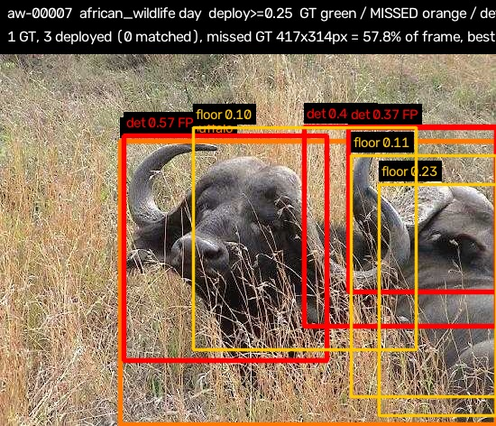
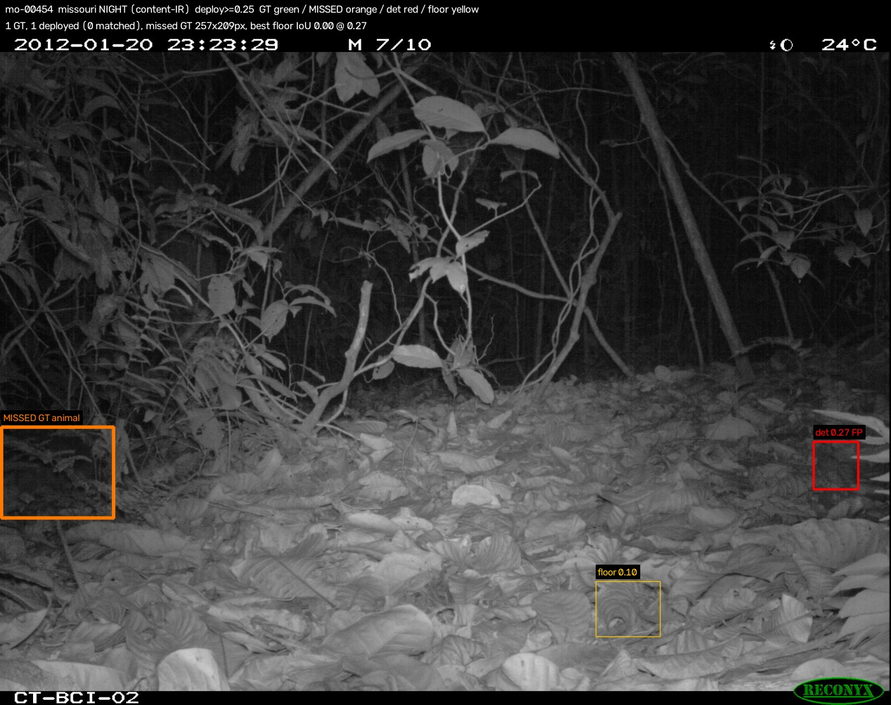
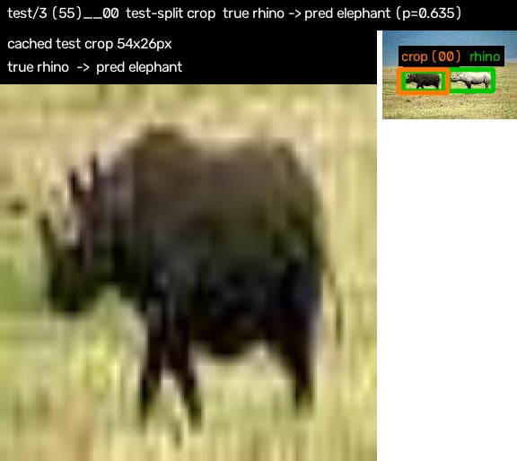
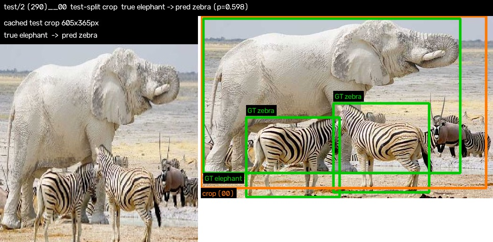
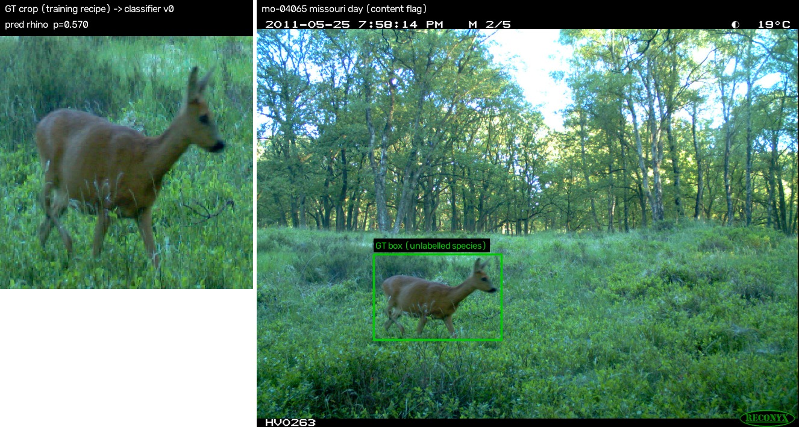
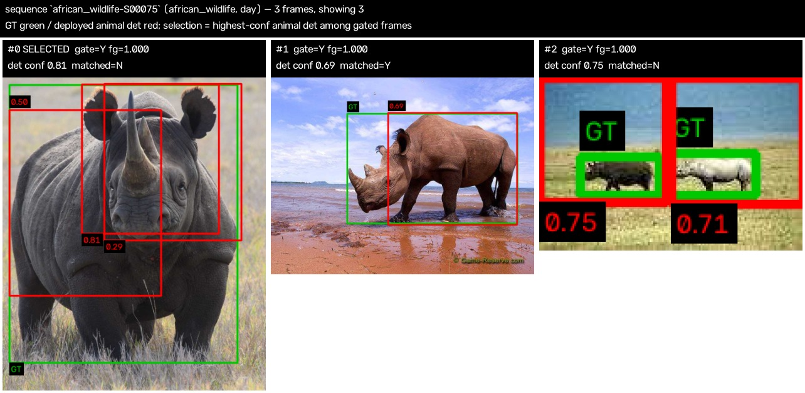
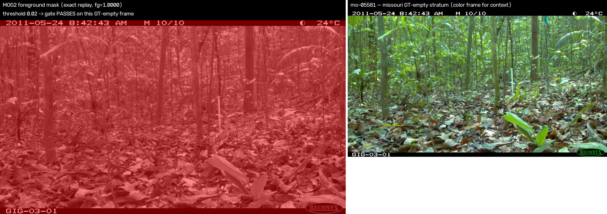

# G3 failure catalog

One annotated image per case under `images/`; numbers below are read
from the same artifacts the eval stages produced (no re-measurement).
Regenerate everything with:

    ../wildlife-monitor/.venv/bin/python -m eval.run_failures

Built from `processed/g3_report.json` (stages: motion, clf, det, seq), the S2 800-image sample + stored cv2.dnn detections, and `processed/g3_motion.parquet`. Deploy conf 0.25, decode floor 0.1, match IoU 0.5 (S2 parity protocol). Day/night = content IR flag (mean HSV saturation < 25.0).

## 1. Missed detection (FN) — day frame, african_wildlife

**Key** — image_id `aw-00007` (african-wildlife/images/test/1 (154).jpg), S2 sample stratum aw_with_gt, split test; pick rule: first AW-day sample image (sample order) with an unmatched GT

- 1 GT box(es); 3 deployed detections (conf ≥ 0.25), 0 matched — 1 GT missed
- missed GT box 417×314 px (57.8% of the frame)
- best sub-deploy detection: IoU 0.42 at conf 0.10 (< 0.25 deploy threshold)
- 3 detection(s) in the 0.10–0.25 band on this frame (drawn yellow)

> Fragmentation of a close-up subject. The GT box spans almost the whole frame (417×314 of 550×412 — a near-camera animal) and MDv6 answers with overlapping boxes that each cover part of the body; the best fragment reaches IoU 0.414 against the full-body GT, below the 0.5 protocol threshold. Under the parity matcher's no-fallback rule every fragment stays unmatched, so this one mechanism costs recall (GT missed) and precision (the fragments count as FPs) on the same frame. The animal is detected — just not as one box; a fragment-merge post-step (or IoU criterion relaxed for very large GT boxes) would recover both numbers.

## 2. Missed detection (FN) — IR night frame, missouri

**Key** — image_id `mo-00454` (missouri/Set1/1.06-Paca/SEQ88168/SEQ88168_IMG_0017.JPG), sequence dir missouri/Set1/1.06-Paca/SEQ88168; pick rule: first missouri-night sample image (sample order) with an unmatched GT and ≥1 deployed det

- IR monochrome frame (content flag: mean HSV saturation < 25.0)
- 1 GT box(es); 1 deployed, 0 matched — 1 missed
- best sub-deploy detection vs the missed GT: IoU 0.00 at conf 0.27

> Blind spot, not a threshold problem: no stored detection at any confidence (floor 0.10) overlaps the GT box — best IoU 0.000 — so no operating-threshold choice recovers this frame. The animal (a paca, folder 1.06-Paca) is a small low-contrast IR target (257×209 px, 1.7% of the frame) hugging the bottom-left frame corner, while the frame's only deployed detection (conf 0.269) sits at the far right — a spatially disjoint false positive. Missouri-night remains the best adequately-sized scope in the detection table (recall 0.8458 at deploy conf vs 0.7945 overall — IR monochrome is not the problem on average; the nominally higher african_wildlife|night 0.9167 rests on 12 GT boxes); the systematic gap is small edge-hugging night targets. Fixes live in the detector input (tiling / edge padding), not in the threshold.

## 3. Species confusion — smallest misclassified crop (upscaling)

**Key** — crop_id `test/3 (55)__00` from source image `african-wildlife/images/test/3 (55).jpg` (AW test split, trainer's 375-crop held-out cache); pick rule: smallest crop area, tie by crop_id

- crop 54×26 px → resized to 224×224 (×4.1 on the long edge) by the training recipe
- true rhino → predicted elephant; top probs: elephant 0.635, buffalo 0.351
- 2 species-labelled GT box(es) on the source frame

> Upsampling past the information content. The crop is 54×26 px (~1.4k source pixels) stretched to 224×224 — ×4.1 horizontally, ×8.6 vertically, aspect-distorting because the training recipe resizes to a square. At that magnification species texture is invented by interpolation, and the confusion lands exactly where grey-on-grey would predict: rhino → elephant. This is the smallest crop in the misclassified set, and rhino — the weakest class in the per-class table (0.9733 vs 0.9848–0.9926) — loses only this crop and one other small one (104×100 px, also upsampled); a min-resolution guard on deployed crops — or an aspect-preserving resize — is the direct fix.

## 4. Species confusion — GT box at the frame edge (truncation)

**Key** — crop_id `test/2 (290)__00` from source image `african-wildlife/images/test/2 (290).jpg` (AW test split, trainer's 375-crop held-out cache); pick rule: smallest area among crops at the frame boundary

- crop 605×365 px → resized to 224×224 (×0.4 on the long edge) by the training recipe
- true elephant → predicted zebra; top probs: zebra 0.598, elephant 0.221
- 3 species-labelled GT box(es) on the source frame

> Truncation at the frame edge. The GT box starts at (0, 0) — the animal is cut by the frame — and the margin expansion clamps against the border, so the crop shows a partial animal. The prediction (elephant → zebra, p=0.598) is a hedge — barely above half — but the closed softmax must still name an AW species. Note the contrast with the tiny-crop case: the two misclassified extremes are a 54×26 px crop and a 605×365 px one, while everything in between sits at 0.99 — v0's errors are concentrated at the edges of its input distribution, not spread across it.

## 5. Out-of-vocabulary — Missouri species through the closed 4-species classifier

**Key** — image_id `mo-04065` (missouri/Set1/1.58-Roe_Deer/SEQ76685/SEQ76685_IMG_0002.JPG), GT box 481×321px; pick rule: first missouri mo_with_gt day sample image (sample order) with a ≥100px GT box; classifier v0 ONNX, cv2.dnn engine new

- dataset directory species context: `1.58-Roe_Deer` (Missouri folders carry species names; box GT is animal-only)
- classifier v0 vocabulary: ['buffalo', 'elephant', 'rhino', 'zebra'] — closed set, no reject option
- forced call on the GT crop: rhino (p=0.570) — a confident AW species for a non-AW animal

> Out-of-vocabulary input with no reject option. Classifier v0's vocabulary is the 4 african_wildlife species; a Missouri roe deer (folder 1.58-Roe_Deer) forced through it comes out 'rhino' at p=0.5704 — a mid-grade, entirely confident-looking answer, because the softmax must distribute its mass over AW classes no matter what is in the frame. This is why G3 reports no classifier metrics for Missouri: without an OOV/none class (or an embedding distance threshold) every such number would be meaningless by construction, and a confidence gate alone would not catch it — 0.57 is not a low confidence.

## 6. Sequence failure — selection picked a frame that missed GT

**Key** — sequence_id `african_wildlife-S00075`, 3 frames (african_wildlife, day); pick rule: first record by sequence_id in report seq.mining.selection_loss

- selected_reason: selected
- 1 gated frame(s) matched GT; the selected frame missed GT match; best gated+matched frame: `aw-00149`
- gate pass on 3/3 frames (MOG2 fg_ratio > 0.02, per-camera warmup excluded)

> Selection optimizes detector confidence, and confidence does not track correctness. All three frames pass the gate (close-up subject, fg_ratio 1.0), so the motion stage is not at fault; the selector then takes the frame with the highest-confidence animal detection — 0.81 on the first frame — and that detection is one of three overlapping fragments, none of which reaches IoU 0.5 with GT (the same close-up fragmentation mode as case 1). The sibling frame one step later has a single 0.69 detection that matches GT cleanly and would have been the right representative. Selection loss is a tail mode, not a systematic flaw (12 of 215 GT sequences, 5.6%; african_wildlife 3/114) — but its mechanism is inherited from the detector: a fragment-merge step before selection would fix both this case and case 1.

## 7. Motion-gate false positive — MOG2 fires on a GT-empty frame

**Key** — image_id `mo-05581` (camera `missouri-L10`, 912 frames), S2 mo_empty stratum; pick rule: highest fg_ratio among gated non-warmup empty frames (camera ≤ 800 frames preferred, tie by image_id); mask replayed with the stage-motion parameters and asserted equal to the cached fg_ratio

- fg_ratio 1.0000 vs trigger threshold 0.02 (50.0×)
- camera `missouri-L10`: 506 of 912 frames gated — every gated frame means a detector call on an animal-free burst
- IR flag on this frame: False (CLAHE applied by the motion stage when IR)

> Stale background model at burst start. fg_ratio is exactly 1.0000 — every pixel flagged foreground — while the neighbouring frames sit at 0.002–0.017, and 21 of the 22 full-foreground frames on this camera are the FIRST frame after a capture gap: MOG2 only updates when a frame arrives, so during an idle gap the model freezes while the scene drifts (vegetation, sun angle, a bumped camera), and the first real frame differs globally from the stale background. The auto learning rate re-adapts within one frame, which is why the spike is isolated. The cost is bounded — one wasted detector call per burst — but on animal-free cameras every burst pays it (this camera gates 506/912 frames). A two-consecutive-frames debounce, or a global-change guard (fg ≳ 0.9 is scene change, not an animal — Missouri animals occupy a few percent of frame), removes the class of trigger.

